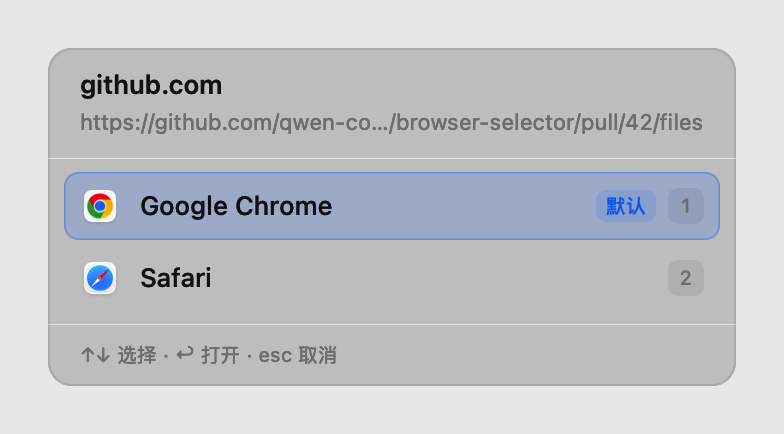

# 浏览器选择器（BrowserSelector）

macOS 菜单栏常驻工具：在目标应用（默认钉钉 / 微信 / QQ）里按应用配置触发，在光标位置弹出浏览器选择面板，用你指定的浏览器打开。未列入目标应用的应用完全旁路，短按也不会影响原有行为。



- Swift + AppKit（EventTap / Accessibility / Launch Services）
- 无网络请求、无后台轮询、无日志落盘
- 空闲常驻 footprint ≈ 14MB，空闲 CPU ≈ 0.01%
- 32 个 Core 单元测试 + Xcode 工程 + 一键打包脚本

性能数据与测量方法见 [PERFORMANCE.md](PERFORMANCE.md)。

## 功能

- **目标应用配置优先**：每个应用独立选择触发方式，未列出的应用完全旁路。
  - `旁路观察（长按）`：默认。短按/拖拽/双击原样透传；按住超过长按阈值（默认 3 秒，可调 0.5–10 秒）且移动很小时，释放时才吞掉 mouseUp、解析链接并弹面板。
  - `吞掉并回放（点击）`：点击立即吞掉并按规则/面板处理；不是链接或解析失败时把原点击回放给应用，不会双开。
- **单实例运行**：启动时持有进程锁并检查同 Bundle ID 实例；重复启动会唤起已运行实例的设置窗口后退出，不会出现多个状态栏图标或重复 EventTap。
- **长按阈值**：仅对「旁路观察（长按）」的应用生效；「吞掉并回放（点击）」应用点击即处理，不等长按。
- **链接提取**：AX 祖先链找 `AXURL` / `AXLinkURL`；钉钉常见的只读消息文本区用 `AXRangeForPosition` 按点击位置匹配 URL；再退到选中文本 / 剪贴板兜底（仅当 AX 完全不可用时，默认延迟 50ms，可配置）。
- **浏览器面板**：纯 AppKit 绘制，不抢焦点；图标 / 默认标记 / `1…9` 快捷键 / ↑↓ / ↩ / esc，右下角有可点击的「取消」。面板显示期间临时注册 Carbon 全局热键，关闭立即注销，不需要输入监控权限。
- **浏览器启动**：`NSWorkspace` 精准指定 App；支持每个浏览器独立的参数模板，`{url}` 占位符，例如 `--incognito --user-data-dir=/tmp/profile {url}`。
- **未注册浏览器**：设置页可手动添加便携版 / 自定义路径的 `.app`，填路径或 Bundle ID 其一即可。
- **域名路由**：正则匹配 host 或完整 URL，命中后跳过面板直接打开；规则按顺序执行（仅「吞掉并回放（点击）」模式）。
- **修饰键**：可选「仅 ⌘+Click 弹面板」，普通点击走规则 / 默认浏览器（仅「吞掉并回放（点击）」模式）。
- **排除规则**：按 Bundle ID 或窗口标题关键字跳过拦截（标题需要屏幕录制权限）。
- **权限引导**：菜单与设置页实时显示辅助功能 / 屏幕录制状态，支持重新检测并启动监听。

## 工程结构

```
Sources/BrowserSelectorCore/     纯逻辑（可单测，不依赖 AppKit）
  AppConfig.swift                配置模型、默认目标应用、合并/清洗
  ConfigStore.swift              原子读写 ~/Library/Application Support/BrowserSelector/config.json
  DomainRouter.swift             正则路由
  ArgumentTemplate.swift         参数模板解析（引号/转义/{url}）
  LinkURLValidator.swift         URL 校验与清洗

Sources/BrowserSelector/         AppKit 常驻进程
  main.swift / AppDelegate.swift 菜单栏、生命周期、点击路由
  SingleInstanceGuard.swift      进程锁 + 同 Bundle ID 实例检查
  ClickMonitor.swift             CGEventTap 创建/停用/吞点击/回放
  ClickGate.swift                回调线程的轻量判定（锁 + 缓存快照）
  LinkExtractor.swift            AX 探测 + 剪贴板兜底
  WindowSnapshotCache.swift      目标应用窗口矩形/标题
  BrowserCatalog.swift           Launch Services 发现 + 浏览器识别
  BrowserLauncher.swift          NSWorkspace 启动与参数注入
  PickerView.swift / PickerController.swift   AppKit 选择面板
  PanelHotKeyManager.swift       面板期间的 Carbon 全局热键（esc / ↑↓ / ↩ / 1–9）
  Settings*.swift                设置窗口（SwiftUI，按需加载）
  Diagnostics.swift              RSS / footprint / CPU 采样

Tests/BrowserSelectorCoreTests/  32 个单元测试
scripts/build-app.sh             release 构建 + .app 打包 + ad-hoc 签名
scripts/benchmark.sh             空闲性能基准
project.yml                      XcodeGen 工程描述
```

## 构建与运行

### 方式一：脚本打包（推荐）

```bash
make app
open build/BrowserSelector.app
```

首次运行：

1. 系统会提示授权辅助功能；到 **系统设置 → 隐私与安全性 → 辅助功能** 勾选 `BrowserSelector`。
2. 菜单栏图标 → **重新检测权限并启动**。
3. 打开钉钉 / 微信 / QQ，**按住左键约 3 秒后松开**链接。

> `scripts/build-app.sh` 使用 ad-hoc 签名。每次重新签名后 TCC 可能要求重新授权；想避免重复授权，请在 Xcode 中换成固定开发团队签名，或使用固定的自签名证书。

### 方式二：Xcode

```bash
make project      # xcodegen generate
open BrowserSelector.xcodeproj
```

在 target 的 Signing & Capabilities 里选择你的 Team，然后 Run。工程同时包含 `BrowserSelectorCoreTests` scheme。

### 命令行构建 / 测试

```bash
swift build
swift test
swift build -c release
```

## 配置

配置文件：`~/Library/Application Support/BrowserSelector/config.json`（启动、修改时读写，运行期纯内存）。

菜单 → **设置…** 可完成绝大部分配置。手工编辑示例：

```json
{
  "behavior": {
    "longPressDurationMilliseconds": 3000,
    "panelOnlyWithCommandModifier": false,
    "clipboardFallbackDelayMilliseconds": 50
  },
  "targetApplications": [
    {
      "displayName": "钉钉",
      "bundleIdentifier": "5ZSL2CJU2T.com.dingtalk.mac",
      "mode": "observe",
      "isEnabled": true
    }
  ],
  "browsers": [
    {
      "id": "com.google.Chrome",
      "displayName": "Google Chrome",
      "bundleIdentifier": "com.google.Chrome",
      "applicationPath": "/Applications/Google Chrome.app",
      "argumentsTemplate": "--incognito {url}",
      "isEnabled": true,
      "isManual": false
    }
  ],
  "routingRules": [
    {
      "id": "1B4E28BA-2FA1-11D2-883F-0016D3CCA427",
      "pattern": "(^|\\.)corp\\.com$",
      "browserID": "com.apple.Safari",
      "isEnabled": true
    }
  ],
  "exclusions": {
    "bundleIdentifiers": [],
    "windowTitleSubstrings": ["会议"]
  },
  "defaultBrowserID": "com.google.Chrome"
}
```

说明：

- `targetApplications[].mode`：`observe`（旁路观察，长按触发）或 `swallowAndReplay`（吞掉并回放，点击即触发）。未列出的应用完全旁路。
- `longPressDurationMilliseconds`：长按阈值，默认 `3000`；设置页以秒展示，可调 0.5–10 秒，**仅对 `observe` 应用生效**。
- 旧版本的 `behavior.triggerMode` 字段会被忽略；触发方式现在由每个目标应用的 `mode` 决定。
- `pattern` 是 ICU 正则，先匹配 host，再匹配完整 URL；JSON 中反斜杠要写成 `\\`。
- `argumentsTemplate` 为空时走 `NSWorkspace.open([url], withApplicationAt:)`；非空时把模板解析成 argv 并注入 URL。模板没有 `{url}` 时，URL 自动追加到末尾。
- 参数模板由用户按浏览器实际支持的参数填写（例如 Safari 不接受 `--new-window` 这类 Chrome 参数）。
- 钉钉的 Bundle ID 会随渠道/版本变化（本机为 `5ZSL2CJU2T.com.dingtalk.mac`）；如果点击没有反应，请在「目标应用」里添加实际 Bundle ID。
- 新发现的浏览器会合并进配置；已有的名称、参数、启用状态不会被覆盖。手动添加的条目优先于自动发现。

## 工作流程

```
左键按下
  └─ EventTap 回调（约 0.1µs）：查目标应用与模式（全部为缓存态判断）
       ├─ 未列入目标应用 / 被禁用 / 命中排除规则 → 完全透传
       ├─ 吞掉并回放（点击）→ 立即吞掉 mouseDown → 后台解析
       │     ├─ 失败 → 回放原点击给应用
       │     └─ 成功 → 域名规则 / 默认浏览器 / 面板
       └─ 旁路观察（长按）→ 只记录坐标/时间，事件透传
            └─ 左键释放
                 ├─ 按住 < 长按阈值 或 移动 > 8pt → 透传，应用照常处理
                 └─ 按住 ≥ 阈值 → 吞掉 mouseUp
                      └─ 后台解析：AX → 选中文本 → 剪贴板兜底
                           ├─ 失败 → 回放 mouseUp 给应用
                           └─ 成功 → 选择面板 → NSWorkspace 启动
```

性能约束落实位置：

- 回调内不调用 `NSWorkspace`、AX、窗口枚举、磁盘/网络；短按只写一个很小的状态结构。
- 面板首次需要时创建，关闭时 `contentView = nil` 并释放。
- 浏览器列表只在首次启动或手动刷新时扫描，结果缓存进配置。
- 发布构建不写日志（`Log` 仅在 `DEBUG` 输出）。

## 调试与基准

```bash
# 空闲内存 / CPU（2s 预热 + 指定时长）
swift build -c release
.build/release/BrowserSelector --benchmark 5

# 面板显示 / 关闭后的 footprint
.build/release/BrowserSelector --benchmark-panel

# 点击闸门微基准（ns/call）
.build/release/BrowserSelector --benchmark-click

# 长按阈值/短按/拖拽状态机自测
.build/release/BrowserSelector --test-longpress

# 点击链路诊断（gate 判定、AX 提取结果、面板浏览器列表）
.build/release/BrowserSelector --trace-clicks

# 离屏渲染面板 PNG（不需要屏幕录制权限）
.build/release/BrowserSelector --render-preview /tmp/panel.png

# 直接在屏幕中央预览面板，观察真实毛玻璃效果
.build/release/BrowserSelector --preview
```

菜单里还有 **测试光标处链接**（读取光标处 AX/剪贴板结果，结果窗口支持「取消」/Esc）和 **预览选择面板**。

基准模式会在结束时自行退出，不会注册辅助功能授权弹窗。运行基准/自测前请先退出已运行实例（单实例锁会阻止第二个进程）。

## 已知限制

- **首次点击非前台/长按未命中**：EventTap 的前台应用缓存依赖窗口激活；在应用尚未成为前台时立刻长按，可能不会触发，先点一下窗口再长按即可。
- **未列入目标应用的应用不会触发**：如果希望在某个应用里使用长按选浏览器，请在「目标应用」里添加它并选择「旁路观察（长按）」。
- **长按触发会吞掉 mouseUp**：极少数应用可能保留“按下”视觉状态，切回应用后点一次即可恢复；这是为了阻止应用自己打开链接、避免双开。
- **「吞掉并回放（点击）」模式下的拖拽**：会拦下目标窗口内的左键按下，拖拽选择文本会失效；改用「旁路观察（长按）」即可保持短按/拖拽透传。
- **剪贴板兜底只在 AX 完全不可用时启用**。AX 可读但没有 URL 时直接结束，避免每次普通点击都等待 50ms。若旧版微信/QQ 点击链接时不会把链接复制到剪贴板，兜底也无法生效，此时释放事件会被回放给应用（由应用自己打开）。
- **窗口标题排除**依赖屏幕录制权限；未授权时仅按 Bundle ID 排除。
- **AX 差异**：部分应用（如钉钉）的链接没有 `AXURL`，URL 位于只读消息文本区；已支持按点击位置提取。输入框里键入的 URL 会被跳过，不会误弹面板。
- **面板热键会临时占用** Esc / 数字 / 方向键 / 回车；若与常驻热键冲突，个别键可能注册失败，鼠标点击始终可用。
- **未实现开机自启**（可后续接 `SMAppService`）。
- **ad-hoc 签名**每次重建可能重置辅助功能授权；开发期建议固定签名。
- 面板显示后 footprint 会高于 15MB（AppKit 窗口基线所致，见 PERFORMANCE.md）；空闲常驻满足 ≤15MB。

## 安全与隐私

- 不发起任何网络请求，不写运行日志，不采集链接内容。
- 配置只保存在本机 Application Support 目录。
- 链接仅在用户选择浏览器后交给 `NSWorkspace`。

## 测试

```bash
swift test
```

覆盖：参数模板（引号/转义/占位符）、URL 校验与标点清洗、域名正则优先级与非法规则、配置容错解码/往返/合并/清洗、配置原子读写与损坏归档。

## License

内部项目示例，未附带开源许可证。
